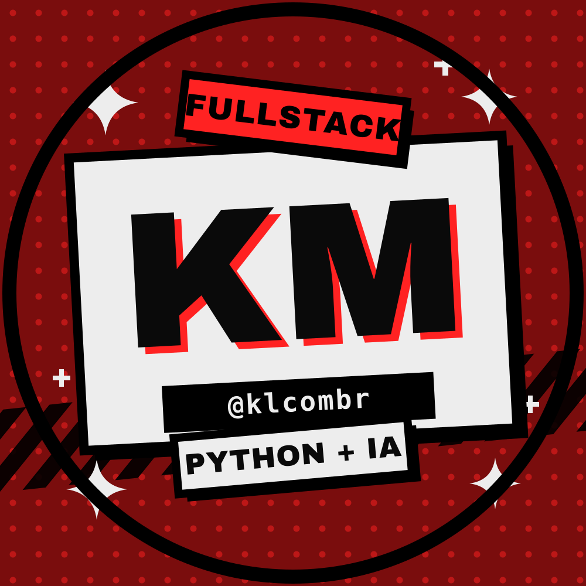

# KAUÊ LEANDRO FARIAS MONTEIRO

**Dev full-stack · Python + IA · Praia Grande — SP**

*"Desenvolvendo projetos para solucionar problemas."*

## ▸ Sobre mim

Estudante de ensino médio (conclusão **2026**, E.E. Alfredo Reis Viegas) e dev full-stack
autodidata — escrevo código desde **2024** e publico tudo que faço aqui. Fui **Aluno Monitor do
BEEM 2026** (96h certificadas pela Secretaria de Educação do Estado de SP).

- **Backend com Python** no comando (FastAPI, NestJS, SQLite, JWT, REST) — mas entrego o stack
  inteiro: Next.js, HTML/CSS/JS no front.
- **IA-native**: integro APIs de LLM (GPT/Gemini) nos projetos, engenharia de prompt e agentes
  com intenção — sei quando a IA acelera e quando só adiciona ruído.
- **Matemática aplicada**: lógica, álgebra e estatística viram modelagem de dados, métricas e
  decisões técnicas.
- **Git/GitHub** no dia a dia: repositório público é meu currículo — o código não mente.

## ▸ Stack & keywords

## ▸ Projetos (completos e públicos)

| Projeto | O que é | Stack |
|---|---|---|
| **[schoolflow](https://github.com/klcombr/schoolflow)** ⭐ | Sistema SaaS para gestão operacional de escolas | NestJS · Next.js · TypeScript · SQLite |
| **[URL-shortener](https://github.com/klcombr/URL-shortener)** | Encurtador full-stack com JWT, links customizados e analytics de cliques | FastAPI · Python · JWT |
| **[atende-bot](https://github.com/klcombr/atende-bot)** | Bot de atendimento automatizado para pequenos negócios via WhatsApp | Python · Automação |
| **[Serpentia](https://github.com/klcombr/Serpentia)** | Laboratório de código interativo: exercícios de lógica com feedback inteligente | Python · Lógica |
| **[openbridge](https://github.com/klcombr/openbridge)** | Hub pessoal celular ↔ PC — Node puro, zero dependências | Node · PWA |
| **[realtime-dashboard](https://github.com/klcombr/realtime-dashboard)** | Dashboard em tempo real: gráficos ao vivo, alertas e monitoramento | JavaScript · WebSocket |
| **[quick-site](https://github.com/klcombr/quick-site)** | Gerador de landing pages para pequenos negócios a partir de um JSON | Python |
| **[foco](https://github.com/klcombr/foco)** | Site de estudos com pomodoro, streaks e gamificação | HTML/CSS/JS |

Mais **42 repositórios públicos** no meu perfil → [github.com/klcombr](https://github.com/klcombr)

## ▸ Experiência & acadêmico

- **Aluno Monitor — BEEM 2026** · Secretaria de Educação do Estado de SP · **96h certificadas**
  Apoio a estudantes em recomposição de aprendizagem: conteúdo, exercícios e participação em sala.
- **TCC — “A Lógica por Trás da Rede”** · Algoritmos e plataformas sociais
  ([apresentação no GitHub](https://github.com/klcombr/apresentacao-logica-rede))

## ▸ Cursos concluídos

`Python — SoloLearn` · `Programação — Alura` · `Desenvolvimento de Jogos` · `Inglês — Speak`

## ▸ Educação

**Ensino Médio — E.E. Alfredo Reis Viegas** · 2024 — 2026 (conclusão)
+ estudo contínuo autodidata desde 2024 nos próprios projetos e repositórios.

## ▸ Contato

<b>[kldev.xyz@gmail.com](mailto:kldev.xyz@gmail.com)</b> ·

Aberto a oportunidades, colaborações e projetos — respondo rápido por e-mail.

---

Feito à mão — sem template, sem contador de estrelas, sem métrica inventada. Só o que existe. ⚡

